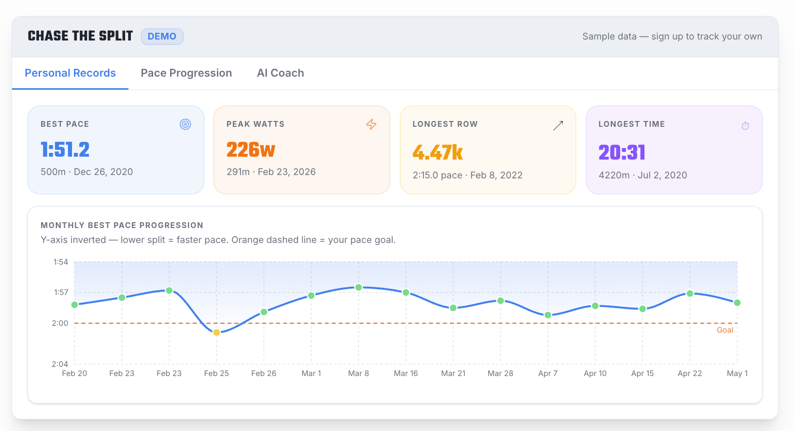

import Mountain from '@site/static/img/undraw_docusaurus_mountain.svg';
import Tree from '@site/static/img/undraw_docusaurus_tree.svg';
import Coach from '@site/static/img/undraw_docusaurus_react.svg';

  

    <Mountain role="img" style={{height: 200, width: 200}} />
    <h3>Personal Records</h3>
    
Track your all-time best splits across every distance, updated
    automatically with each workout you import.

  

  

    <Tree role="img" style={{height: 200, width: 200}} />
    <h3>Pace Progression</h3>
    
Your journey to goal pace, visualized — filter by 15 days to a full
    year and see the trend, your best split, and your In Zone count.

  

  

    <Coach role="img" style={{height: 200, width: 200}} />
    <h3>AI Coach</h3>
    
Turn your data into a plan: ask what to row tomorrow, why your pace
    stalled, or how close you are to your goal.

  

